<div align="center">

# 🐉 Hic Sunt Dracones

### *Terra cognita ends at the last commit. Beyond it, there be dragons.*



</div>

<details>
<summary>🗺️ View the map in ASCII (for those who read assembly)</summary>

```text
+========================================================================================+
|     MAPPA  MVNDI  CODICIS      ~  Tabula Maris Incogniti  ~      drawn anno MMXXVI     |
+========================================================================================+
|   /\/\/\/\  PYRENAEI  MONTES  /\/\/\                                          N        |
|  /\/\/\/\/\/\  ( firewall )  /\/\/\/\/\   ~         ~         ~          NW   |   NE   |
|  |                                    \__                                  \ .|. /     |
|  |    T E R R A    C O G N I T A        \__     ~      ~          ~     W --( + )-- E  |
|  |    ( production, mostly tested )        \                               / '|' \     |
|  |                                          \       |>    |>    |>       SW   |   SE   |
|  |      * Barcino  ( Barcelona )             )     )_)   )_)   )_)            S        |
|  |        ~ git push origin main ~          /     )__)  )__)  )__)    ~                |
|  |                                        _/   ___|_____|_____|___         ~           |
|  |    * Tarraco  ( staging )             /     \  o   o   o   o  /   ~                 |
|  |                                     _/   ~~~~\_______________/~~~~      .--._       |
|  |    * Valentia  ( QA, abandoned )   /          NAVIS  MAIN BRANCH      _/     '-.    |
|  |                                  _/    ~        ~          ~         (  MAIORICA )  |
|  \___                           __/          .--.                      '-.______.'     |
|      '--.__     ____.---.____.-'     ~      ( EB )      ~                (localhost)   |
|            '---'                           '--' Ebusus           .-.                   |
|  ~      ~        ~        ~       ~         (party mode)        ( . ) Minorica         |
|                                                                  '-'   (127.0.0.1)     |
|     ~  .  ~   M A R E    P V L L    R E Q V E S T V M   ~  .  ~      ~        ~        |
|        ~        ~   ( LGTM tides, merge conflicts at full moon )   ~        ~          |
|. . . . . . . . . . . . . . . . . . . . . . . . . . . . . . . . . . . . . . . . . . . . |
|  HIC DESINIT DOCVMENTATIO                                  INCIPIT CODEX HEREDITARIVS  |
|  (here ends the documentation)                         (beyond lies the legacy code)   |
|. . . . . . . . . . . . . . . . . . . . . . . . . . . . . . . . . . . . . . . . . . . . |
|                                                                                        |
|       __                          /\_/\                            ___                 |
|   ~  ( oo)__/\/\/\/\/\__    ~    ( o.o )~~~~      ~      ~      _/ o o\_     ~         |
|       \__/ ~~~\/\/\/\/\/~~        > ^ <    ~                   (  ___  )               |
|     SERPENS  NVLLPTR            FELIS  SEGFAULT       ~        /\/\/ \/\/\    ~        |
|   (deref at your own peril)    (core dumped, x9)              KRAKEN DEADLOCK          |
|  ~        ~        ~        ~        ~        ~        ~     (waits for itself)        |
|                                                                                        |
|     _   _   _   _   _                                        .-.                       |
|    (o) (o) (o) (o) (o)       ___.--~~~~~~--.___             (o o)   ~@~@~@~@~          |
|     \\  \\  ||  //  //    .-'  o              '--.____      /|~|\  @~@~@~@~@           |
|      \\__\\_||_//__//    <  (((                   ___ '~~~~> /_)_(\  ~@~@~@~@~         |
|       \___________/       '-.___   ~~~ ~~~ ___.--'  RAM++   ~~~ ~~~ ~~~                |
|    HYDRA  DEPENDENTIARVM        '--.______.--'             SIRENA  SPAGHETTIS          |
|   (cut one head: npm         LEVIATHAN  MEMORY  LEAK      (sings in goto,              |
|    installs forty-two)      (never free()d, never sated)   lures you to rewrite)       |
|                                                                                        |
|           H   I   C       S   V   N   T       D   R   A   C   O   N   E   S            |
|                                                                                        |
|   ~  .  ~  0x00000000  ~  .  ~  undefined  ~  .  ~  NaN  ~  .  ~  /dev/null  ~  .  ~   |
+========================================================================================+
```

</details>

<div align="center">

**Legenda**

| Sign | Meaning |
|:---:|:---|
| `*` | known lands, mostly tested |
| `~` | open waters of open source |
| `. . .` | the edge of the documentation |
| 🐉 | uncharted code: here be dragons |

**Bestiarium**

| Creature | Habitat | Danger |
|:---|:---|:---|
| 🐍 **Serpens Nullptr** | uninitialised pointers | deref at your own peril |
| 🐈‍⬛ **Felis Segfault** | the core dump barrel | nine lives, nine crashes |
| 🐙 **Kraken Deadlock** | two threads, two mutexes | waits for itself, forever |
| 🐉 **Hydra Dependentiarum** | `node_modules` | cut one head, npm installs 42 |
| 🐋 **Leviathan Memory Leak** | the heap | never `free()`d, never sated |
| 🧜 **Sirena Spaghettis** | legacy shallows | sings in `goto`, lures you to rewrite it |

*Navigare necesse est, compilare non est necesse.*

<sub>578 repositories charted so far. Travellers enter at their own risk; pull requests welcome.</sub>

</div>
